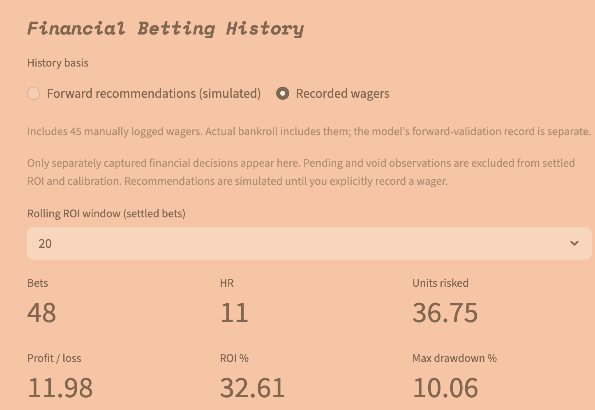
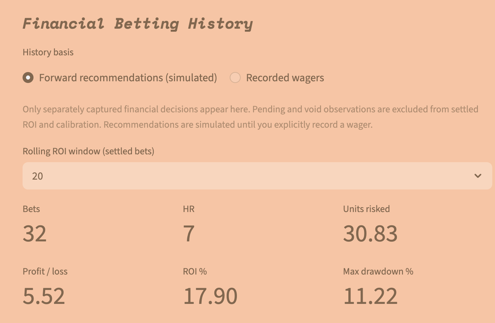

# Financial Decision System

A downstream research layer compares model evidence with an observed price,
estimates uncertainty, and keeps recommendations separate from recorded wagers.
It does not execute bets or change upstream rankings.

The central question is whether a player's offered price is supported by enough
evidence, then whether the portfolio has capacity for that exposure. The
[expanded financial model card](model_cards/financial_system.md) walks through
the matching rules, probability formulas, optional regression, eligibility gates,
allocation algorithm, and recordkeeping.

## Results in the Dashboard

The financial dashboard tracks simulated recommendations separately from bets
I chose and recorded. These screenshots were taken on October 12, 2026.

### Bets I Selected

These are bets I selected and logged, not an automatically placed model portfolio.
The dashboard shows 48 bets, 11 home runs, and 36.75 units risked, with a profit
of **11.98 units** and **32.61% ROI**. Displayed maximum drawdown is 10.06%.

### Simulated Recommendations

This view tracks the system's forward recommendations as simulated bets,
separately from my recorded wagers. It shows 32 bets, 7 home runs, and 30.83 units
risked, with a simulated profit of **5.52 units** and **17.90% ROI**.
Displayed maximum drawdown is 11.22%.

These are small samples of dashboard results, not proof of long-term profitability.
The screenshots do not show the start and end dates of the tracked bets. The
20-bet setting controls the rolling ROI window, not the totals reported above.

## Worked Example: Positive EV but WATCH

This is a synthetic calculation using the default code settings, not a real
player, historical result, or suggested wager. Assume a fresh pregame quote,
confirmed lineup, valid model probability and mapped signal, and no existing wager.

| Input | Assumed value |
| --- | --- |
| Offered American odds | +500, equivalent to decimal 6.00 |
| Base-model HR probability | 22% |
| Matched historical player-days | 40 |
| Home runs in those observations | 12, a raw rate of 30% |
| Distinct matched dates | 10 |
| Disjoint prior-adjustment peers | None |

At +500, break-even is `1/6`, or 16.67%. The starting prior averages that with
22%, giving 19.33%. The effective sample is capped at twice the ten distinct
dates, so only 20 effective observations enter the update.

With default prior strength 30, the Beta parameters become `alpha = 11.8` and
`beta = 38.2`. Calling the implementation with those inputs gives:

| Output | Calculated value |
| --- | --- |
| Posterior mean HR probability | 23.60% |
| 90% credible interval | Approximately 14.45% to 33.96% |
| Probability of positive EV | Approximately 88.26% |
| Probability edge | +6.93 percentage points |
| Expected profit per unit | +0.416 units |
| Classification | MARGINAL / WATCH |
| Recommended stake | 0 units |

The mean EV is positive, the raw sample exceeds 25, and the interval is narrower
than 20 percentage points. However, confidence that the price is favorable is
88.26%, below the default 90% requirement. The saved reason is
`UNCERTAINTY_HIGH`. A favorable mean estimate therefore does not automatically
produce a BET.

The arithmetic Kelly ceiling would be 2.08 units at quarter Kelly on a 100-unit
bankroll, before the one-unit player cap and shared limits. It is not allocated
because the eligibility check failed. P(positive EV) also must not be confused
with the 23.60% estimated chance of the home-run event itself.

## How to Explore a Decision

1. Start with the exact sportsbook quote, its timestamp, and game identity.
2. Compare break-even with the base and final probabilities.
3. Inspect matched observations, distinct dates, effective sample size, and the
   uncertainty interval. Several overlapping labels are not separate outcomes.
4. Read every eligibility reason before interpreting the suggested stake.
5. Inspect exposure caps and recorded stakes to understand any allocation limit.
6. When reviewing results, choose explicitly between simulated forward decisions
   and recorded wagers. Compare outcomes with the saved decision-time estimates.

For reproducibility, each run's `FINANCIAL_SYSTEM/` folder stores decisions,
model information, configuration, and a manifest. Revision folders preserve
decisions, settings, model details, and the deduplicated training player-days.
The separate local SQLite ledger retains snapshots, the first pregame cohort,
recorded wagers, and outcomes. These private operational artifacts are excluded
from Git; the public portfolio documents their structure and code.

## Implemented Method

The default prior combines offered-price break-even and available base-model
probability. Historical peers are conditioned on price and base probability.
Overlapping labels are deduplicated, and effective observations are capped.
A Beta posterior supplies probability estimates and uncertainty intervals.
These are modeling assumptions, not proof of independent evidence or an edge.

An optional regularized logistic model uses market logit as an offset. It is
disabled by default and must pass chronological validation and improve market
Brier score before use. Its uncertainty is approximate. See
[meta_model.py](../all_seeing_eye/financial_system/meta_model.py).

## Price and Eligibility

For decimal price `d` and probability `p`, code uses break-even `1/d`, expected
return per unit `p*d - 1`, and nonnegative Kelly
`max(0, (p*d - 1)/(d - 1))`. Offered-price break-even includes bookmaker margin;
it is not a margin-free true probability. These describe implementation rather
than advice to wager.

Defaults include a 90% credible interval, 25 matched observations, minimum
1.5-percentage-point edge, and quotes no older than 60 minutes. Eligibility also
checks uncertainty, lineup status, and game timing. Fractional Kelly and
player/day/game/team/family/model caps constrain allocations.
Defaults live in [config.py](../all_seeing_eye/financial_system/config.py);
private saved settings can differ.

## History and Evaluation

Decision snapshots, the first pregame cohort, recorded wagers, and outcomes are
stored separately. Refreshing recommendations must not rewrite the original
forward cohort. Actual prices/stakes and simulated recommendations have separate
accounting bases. Pending results are not losses; voids are excluded from settled
ROI and calibration. Grading does not create a wager.

Historical signal discovery remains retrospective even when later analysis uses
date-separated validation. Posterior confidence is conditional on assumptions.
The screenshots above report dashboard totals; the private ledger and source
archive are not included for independent reproduction.

A public evaluation should disclose dates, sample sizes, selection rules,
coverage, calibration, baselines, and simulated versus actual accounting.

## Explore the Code

- [Posterior](../all_seeing_eye/financial_system/posterior.py) and [pricing](../all_seeing_eye/financial_system/pricing.py)
- [Decisions](../all_seeing_eye/financial_system/decisions.py) and [engine](../all_seeing_eye/financial_system/engine.py)
- [History](../all_seeing_eye/financial_system/history.py) and [results](../all_seeing_eye/financial_system/results.py)
- [Model card](model_cards/financial_system.md)
- [Detailed operating reference](../FINANCIAL_DECISION_SYSTEM.md)

Tests cover chronology, caps, eligibility, immutable captures, and settlement.
Passing them supports implementation reliability, not profitability.
