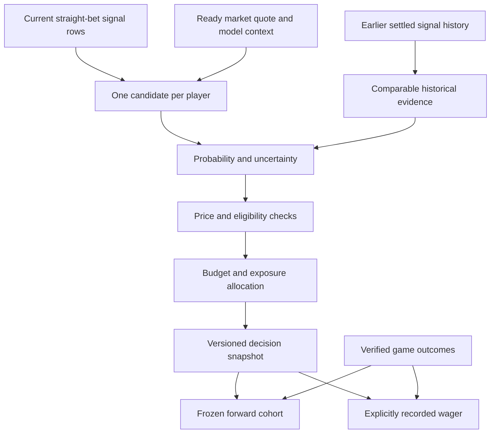

# Financial Model: Probability, Price, and Portfolio Decisions

## What the System Does

The financial model asks: **Does the available evidence justify this player's
offered price, and how much exposure can the portfolio support?**

A high baseball-model rank does not answer that question by itself. The same
player can be attractive at one price and unattractive at another. Evidence can
also be too uncertain to act on, even when the estimated average return is
positive.

This system connects baseball predictions to a recorded decision process:
assemble comparable historical observations, estimate a probability distribution,
evaluate the price, apply eligibility checks, and allocate a constrained budget.
It preserves the reasoning so the decision can later be compared with outcomes.

The implementation is in
[financial_system](../../all_seeing_eye/financial_system/).
It does not execute wagers or change the upstream model rankings. The calculations
below describe the software and its research assumptions, not recommended wagers.

See [results in the dashboard](../financial_decision_system.md#results-in-the-dashboard)
for screenshots of my selected bets and the system's simulated recommendations.

## How Players Reach the Financial System

Players enter through the daily signal board. Each signal is a specific
combination of model rankings, patterns, and sportsbook prices. Examples include:

| Signal | What qualifies a player |
| --- | --- |
| Mid-price edge | GBM top 25, odds +401 to +500, and a probability edge of 0-2.5 percentage points |
| Price-and-edge signals | GBM top 25, odds +301 to +400 or +501 to +650, and an edge of 2.5-5 points |
| Rank-and-edge signals | GBM ranks 1-5 with a 2.5-5-point edge, or ranks 11-25 with a 0-2.5-point edge |
| Sequence confirmation | A high-lift five-step pattern, GBM top 10, and odds +301 to +400 |
| Pitch-fit longshots | Odds +500 to +900, GBM ranks 40-130, and matchup rank 30 or better |
| Sharper pitch-fit | Odds +500 to +800, GBM ranks 20-100, and matchup rank 10 or better |

Some pitch-fit rules then select the best Eye rank, the two strongest price
edges, or the two highest model probabilities. This gives players different
ways to surface, including favorable matchups that are not near the top of
the GBM.

Matching a signal starts the evaluation; it does not automatically produce a
bet. The historical ROI beside a signal describes its past results, not the
expected return for today's player.

## Turning Signals Into a Probability

The default calculation combines the GBM probability, today's price, and earlier
results from comparable signals.

First, American odds become decimal odds, `d`. At +500, `d = 6.00`, so the
break-even probability is `1 / 6 = 16.67%`.

The starting probability averages that break-even rate with the GBM estimate.
Historical players in the same odds bucket and within five percentage points
of the GBM estimate can adjust that starting point. Peers without overlapping
signal labels inform the prior; players sharing an exact signal label supply
the evidence used to update it.

Multiple labels for the same historical player-day count only once. The system
also reduces the weight of observations clustered on the same dates:

```text
effective sample = min(matched player-days, 2 * distinct dates, 100)
```

With starting probability `p0`, historical hit rate `r`, and default prior
strength 30:

```text
alpha = 30 * p0       + effective sample * r
beta  = 30 * (1 - p0) + effective sample * (1 - r)
estimated HR probability = alpha / (alpha + beta)
```

This Beta-distribution calculation keeps a small, unusually successful sample
from completely overriding the starting estimate. It also produces an uncertainty
interval and the estimated probability that the player's true HR chance exceeds
break-even.

## Comparing Probability With Price

For estimated HR probability `p` and decimal odds `d`:

```text
Probability edge = 100 * (p - 1/d) percentage points
Expected profit per unit = p * d - 1
```

For example, a 23.6% estimate at +500 gives a **6.93-point edge** and
**0.416 units of expected profit per unit risked**. Those are modeled
expectations, not guaranteed returns.

The system separately calculates its confidence that the edge is positive.
A 90% probability of positive expected value does **not** mean a 90% chance
of hitting a home run.

## Deciding Whether to Bet

Default requirements include positive expected value, at least a 1.5-point
edge, 90% confidence in positive value, an uncertainty interval no wider than
20 points, and at least 25 matched historical player-days. The historical hit
rate must also exceed today's break-even rate.

The player must have a usable base probability, recognized signals, a confirmed
lineup, and a valid pregame quote no older than 60 minutes. A positive estimate
can still receive **WATCH** when evidence or conditions are insufficient.

## Sizing and Tracking Positions

The system calculates a quarter-Kelly stake ceiling:

```text
Full Kelly fraction = max(0, (p * d - 1) / (d - 1))
Stake ceiling = bankroll * Full Kelly fraction * 0.25
```

Eligible players share available capacity subject to individual ceilings and
limits by player, day, game, team, and signal/model family. Defaults include a
100-unit bankroll, a one-unit player cap, and a five-unit daily budget; saved
settings can differ.

Recorded profit uses the actual stake and odds. **ROI is total settled profit
divided by total settled stakes**, while drawdown measures the decline from a
previous bankroll peak. Simulated recommendations and personally recorded bets
remain separate.

The optional market-offset regression is a separate research method, disabled
for decisions by default. It learns adjustments to market probabilities and
must beat the market benchmark on chronological held-out Brier score before
it can replace the default calculation.

## Where It Fits



The candidate universe consists of players appearing in the current straight-bet
signal output, not every MLB hitter. A player must match exactly one market row
marked ready. Missing or ambiguous market matches are omitted before financial
classification; they are not automatically given a PASS row.

## Inputs and Evidence Preparation

| Input | How it is used |
| --- | --- |
| Base-model probability | Starting probability context and historical matching |
| Offered odds and sportsbook | Break-even threshold, expected value, and settlement price context |
| Quote timestamp and game start | Freshness and pregame eligibility |
| Lineup status | Confirmed-starter gate, enabled by default |
| Signal labels and model ranks | Evidence matching, family classification, and optional model features |
| Earlier settled results | Historical likelihood and validation |
| Recorded stakes and configuration | Remaining budget, bankroll, and exposure limits |

The current base probability comes from the market board's
`adjusted_hr_probability_percent`; it is not an average of Eye, Sequence, and
matchup ranks. Missing or invalid base probabilities are flagged and cannot
qualify for BET, even though a fallback can support an informational estimate.

Historical rows are restricted to dates before the decision date and settled
HR/No HR outcomes. Multiple signal rows collapse to one normalized player-day
with the union of their labels. Conflicting outcomes and known multiple-game
identities are excluded. When usable historical prices disagree, the shortest
decimal-equivalent price is retained and the conflict is flagged.

A player matching four labels therefore does not supply four independent
home-run outcomes.

## Default Probability Method: Beta Shrinkage

The default method balances a starting expectation with a limited amount of
comparable historical evidence. This is called shrinkage: an extreme observed
hit rate is pulled toward a prior instead of being accepted at face value.

### 1. Construct a Starting Prior

The initial prior is the average of offered-price break-even probability and
available base-model probability, clipped between 1% and 80%.

Historical peers must fall in the same configured odds bucket and have a base
probability within five percentage points of the current player's base value.
For historical rows with missing base probabilities, matching uses their
break-even probability as a fallback.

Peers sharing no exact triggered label with the candidate can adjust the prior.
Their influence is capped at 20 observations against a fixed weight of 30 on the
initial prior. These peer observations are kept separate from the observations
used in the likelihood. The peer-blending weight of 30 is hard-coded; the
subsequent Beta prior strength is separately configurable.

### 2. Select Matching Signal Evidence

The likelihood uses earlier player-days with:

- The same price bucket.
- Similar base-model probability, within five percentage points.
- At least one exact signal label in common.

The union is used, so a historical player-day sharing several labels enters once.
Default positive-odds bucket boundaries are +300, +400, +500, +600, and +800;
negative odds have their own bucket.

### 3. Reduce Effective Sample Size

Let `n` be matched player-days, `h` the number with a home run, and `D` the
number of distinct matched dates. The default effective count is:

```text
n_effective = min(n, 2 * D, 100)
```

This reduces how strongly clustered observations move the estimate. It is a
transparent heuristic, not a proven correction for all player/date dependence.
The minimum-history eligibility gate separately uses the raw matched count.

### 4. Update the Distribution

With prior probability `p0` and configurable prior strength `s` (default 30):

```text
alpha = s * p0       + n_effective * (h / n)
beta  = s * (1 - p0) + n_effective * (1 - h / n)
posterior mean = alpha / (alpha + beta)
```

With no matches, the likelihood contributes zero and the prior remains.
The Beta distribution produces the mean, median, standard deviation, interval,
and probability that the underlying HR probability exceeds today's break-even.

A 90% posterior probability of positive EV is **not** a 90% chance of a home run.
It describes confidence that an uncertain probability is above a price threshold,
conditional on the model assumptions.

## Optional Market-Offset Model

A second method fits ridge-regularized logistic regression. It starts at the
market break-even logit and learns an adjustment using the base-model logit
difference, Eye/matchup/GBM/Sequence rank quality, and signal-family indicators.

It is disabled **for decision use** by default. The engine can still fit and
evaluate it for the Evidence view. Enabling it is not sufficient: its validation
gate must also pass.

Code defaults require at least 150 training player-days, 25 distinct dates, and
both outcome classes. Expanding chronological folds use date boundaries around
55%, 70%, 85%, and 100% of available dates. Each fit uses dates before its test
segment. Promotion requires at least 60 held-out observations and a lower Brier
score than the market break-even benchmark. Lower Brier score means smaller
average squared probability error.

If disabled or unsuccessful at the gate, decisions retain the Beta method.
If active, uncertainty uses a ridge/Laplace approximation on the logit scale with
an added 0.25 latent standard-deviation floor, not an exact Beta posterior.
Historical sample and raw-hit-rate checks still apply.

This benchmark gate is an implementation rule, not a statistical significance
test or a guarantee of improvement on future dates.

## Price, Edge, and Expected Return

For decimal odds `d` and final estimated probability `p`:

| Quantity | Calculation | Interpretation |
| --- | --- | --- |
| Break-even probability | `1 / d` | Hit rate needed to break even at the offered price |
| Probability edge | `100 * (p - 1/d)` | Difference in percentage points |
| Expected value per unit | `p*d - 1` | Model-expected profit per unit staked |
| Conservative EV | Same EV formula using the lower interval bound | Sensitivity to a less favorable probability |
| P(positive EV) | Posterior mass above `1/d` | Model confidence that the price threshold is exceeded |

Offered-price break-even is not a margin-free market estimate of true probability.
Conservative EV is exported for inspection; the classifier gates on posterior
confidence and interval width rather than directly requiring positive conservative EV.

## Decision Rules

| Classification | Code behavior |
| --- | --- |
| BET | Every eligibility check passes and a positive allocation remains |
| MARGINAL / WATCH | Mean EV is positive, but evidence, freshness, lineup, or capacity blocks action |
| PASS | Mean EV is nonpositive, game time is unknown/started, or the player is already recorded |

Default eligibility checks require positive EV, at least 1.5 percentage points
of edge, at least 90% posterior probability of positive EV, an interval width no
greater than 20 percentage points, and at least 25 matched historical player-days.
The matched raw HR rate must also exceed today's break-even rate.

Additional checks require a usable base probability, mapped signal families,
a confirmed lineup, valid pregame timing, and a quote no older than 60 minutes.
Missing quote timestamps and timestamps more than one minute in the future
also fail freshness checks.

Reasons such as `UNCERTAINTY_HIGH`, `SMALL_SAMPLE`, `STALE_PRICE`, and
`ALREADY_RECORDED` are saved with the decision. Rechecking a current view can
expire recommendations without rewriting their frozen historical versions.

See the [worked example](../financial_decision_system.md#worked-example-positive-ev-but-watch)
for a positive-EV candidate that fails the confidence gate.

## Stake Allocation and Concentration

Full Kelly is `max(0, (p*d - 1)/(d - 1))`. The default fractional ceiling is
one quarter of that fraction times the current bankroll. Eligibility comes
first; sizing does not rescue a rejected candidate.

| Code default | Limit |
| --- | --- |
| Starting bankroll | 100 units |
| Single player | 1 unit |
| Daily total | 5 units |
| One game or team | 2 units each |
| One signal family or model family | 3 units each |

These are configurable research defaults, not recommended risk settings.
Private saved settings may differ.

Eligible candidates share the available capacity equally, subject to their
individual Kelly ceilings and all shared caps. Unused capacity is redistributed.
Whole-cent allocation prevents overspending; remainder cents follow descending
P(positive EV), descending EV, then player-key order. This is constrained equal
sharing, not a covariance-based portfolio optimizer.

Recorded stakes consume the selected date's budget, including already settled
wagers. Settlement does not refill that day's allowance. Recorded players are
not recommended a second time. A candidate with no remaining allocation becomes
WATCH.

Every position's full stake counts toward every applicable family/model cap.
Charts may split shared-family stakes for display; that does not change cap
accounting. The field `independent_family_count` counts distinct label-derived
families, not statistically demonstrated independent sources.

## History, Settlement, and Accountability

Three records answer different questions:

| Record | Question it answers |
| --- | --- |
| Versioned decision snapshot | What did the system estimate with these inputs and settings? |
| First pregame player-day cohort | What would a fixed forward research policy have seen initially? |
| Explicitly recorded wager | What stake and price did the user actually record? |

The first pregame cohort is retained even after odds refreshes or settings changes.
It includes captured candidates, not just eventual BET rows. An actual wager
can reference a later snapshot and uses its recorded price and stake. Personal
entries can exist without model context; the system does not invent probabilities
for those entries.

The storage identity is player-day, while result matching uses game/player IDs.
This is not unrestricted multi-game-per-player portfolio support. Unresolved
identities and historical doubleheader ambiguity remain limitations.

Final matching results determine HR/No HR. Missing or incomplete evidence remains
pending, and project-specific no-appearance/pinch-hit rules can produce a Void.
Voids have zero profit and are excluded from settled ROI/calibration.
The local grading rules are not guaranteed to reproduce every sportsbook's terms.

Repeated result checks update the same outcomes instead of creating another
profit transaction. Actual prices and stakes determine realized wager profit;
simulated recommendations do not change actual bankroll.

## What an Analyst Can Inspect

The interface provides Decisions, Evidence, Portfolio, and History & Calibration
views. A decision includes its quote, break-even, base/final probability,
uncertainty, matched evidence, classification reasons, caps, and suggested units.

History compares realized versus expected profit, stake-weighted ROI, drawdown,
calibration, Brier score, and performance by signal/price/confidence groups.
The strategy comparisons use the same first-captured cohort to distinguish
selection/filtering from stake sizing. Overlapping signal-group results must
not be added as if they were separate positions.

Unannualized experimental risk ratios are descriptive; they are not directly
comparable to annualized investment-fund ratios. Missing probability coverage
must be disclosed when reporting model-expected portfolio returns.

## Evaluation Status and Source Map

This card documents implemented methods, not established profitability.
Historical labels were selected retrospectively; chronological validation does
not undo that selection. Small samples, correlated signals, quote availability,
and changing player populations can limit conclusions.

The private ledger and training archive are excluded from the public repository.
Tests demonstrate specific software behaviors, not an independently reproduced
out-of-sample financial result.

| Code | Responsibility |
| --- | --- |
| [data.py](../../all_seeing_eye/financial_system/data.py) | Candidate matching, deduplication, family mapping |
| [posterior.py](../../all_seeing_eye/financial_system/posterior.py) | Priors, matched evidence, Beta uncertainty |
| [meta_model.py](../../all_seeing_eye/financial_system/meta_model.py) | Optional regression and chronological gate |
| [pricing.py](../../all_seeing_eye/financial_system/pricing.py) | Odds, EV, and Kelly formulas |
| [decisions.py](../../all_seeing_eye/financial_system/decisions.py) | Eligibility and constrained allocation |
| [engine.py](../../all_seeing_eye/financial_system/engine.py) | Orchestration, exports, and versioned evidence |
| [config.py](../../all_seeing_eye/financial_system/config.py) | Configurable defaults |
| [history.py](../../all_seeing_eye/financial_system/history.py), [results.py](../../all_seeing_eye/financial_system/results.py) | Captures, records, and settlement |
| [metrics.py](../../all_seeing_eye/financial_system/metrics.py) | Evaluation and portfolio measurements |

The [system guide](../financial_decision_system.md) provides a worked calculation
and an exploration path. The [operating reference](../../FINANCIAL_DECISION_SYSTEM.md)
describes the dashboard controls in detail.
