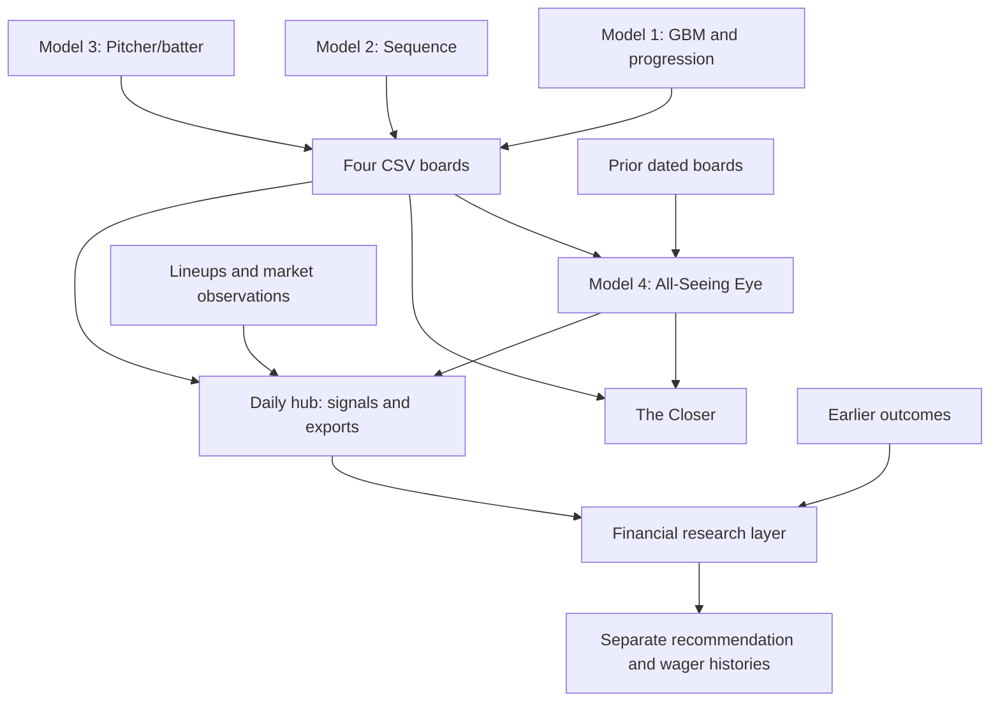

# Model Overview

Model 4 combines existing baseball model rankings to prioritize human review.
It supports investigation through explanations, historical tracking, and a
daily Streamlit dashboard.

## Architecture

This is a conceptual flow. The standalone Eye CLI runs independently of the hub,
network feeds, and financial layer. The Closer is available through the menu.

## Code Map

| Component | Implementation | Purpose |
| --- | --- | --- |
| Input contract | [boards.py](../all_seeing_eye/boards.py), [io.py](../all_seeing_eye/io.py) | Load boards and join players/history |
| Eye ranking | [scoring.py](../all_seeing_eye/scoring.py) | Movement, agreement, disagreement, persistence |
| CLI | [cli.py](../all_seeing_eye/cli.py) | CSV and Markdown output |
| Closer | [closer.py](../all_seeing_eye/closer.py) | Candidate review |
| Integration | [runner.py](../all_seeing_eye/daily_hub/runner.py) | External models, snapshots, refreshes |
| Dashboard | [app.py](../all_seeing_eye/daily_hub/app.py) | Daily analysis |
| Financial layer | [financial_system](../all_seeing_eye/financial_system/) | Uncertainty, eligibility, accounting |
| Verification | [tests](../tests/) | Unit and regression checks |

The CLI imports the package's `all_seeing_eye/scoring.py`. The existing root-level
`scoring.py` is not its entry point.

## Scope and Interpretation

Models 1-3 are external projects. Their full training pipelines and fitted
artifacts are not included here. The expanded [Sequence model card](model_cards/model_2_sequence.md)
also documents its locally inspected upstream implementation: 14-day Statcast
features, ordered plate-appearance motifs, a gradient-boosted estimator, and
subsequent scouting adjustments. Its exported rank reflects that adjusted score,
not simply the estimator's probability.
Model 1 supplies both the GBM and positive-regression/progression board.
That regression board is distinct from Model 3's pitcher/batter board.

Eye scores indicate review priority; Closer scores indicate heuristic conviction.
Neither is a home-run probability. Agreement does not establish independence:
multiple boards can share underlying information.

## Evaluation Status

The public example uses synthetic data. Tests establish software behavior, not
forecasting skill. Private historical archives are not distributed here.

A reproducible performance study should freeze pregame forecasts, identify
player-game observations, separate training/evaluation dates, disclose sample
sizes and missing coverage, and compare appropriate baselines. Probability
models need calibration and scoring-rule evaluation; ranking systems need
ranking-based evaluation. Rules discovered from historical results need a later,
untouched evaluation period. These are research requirements, not completed
performance claims.
