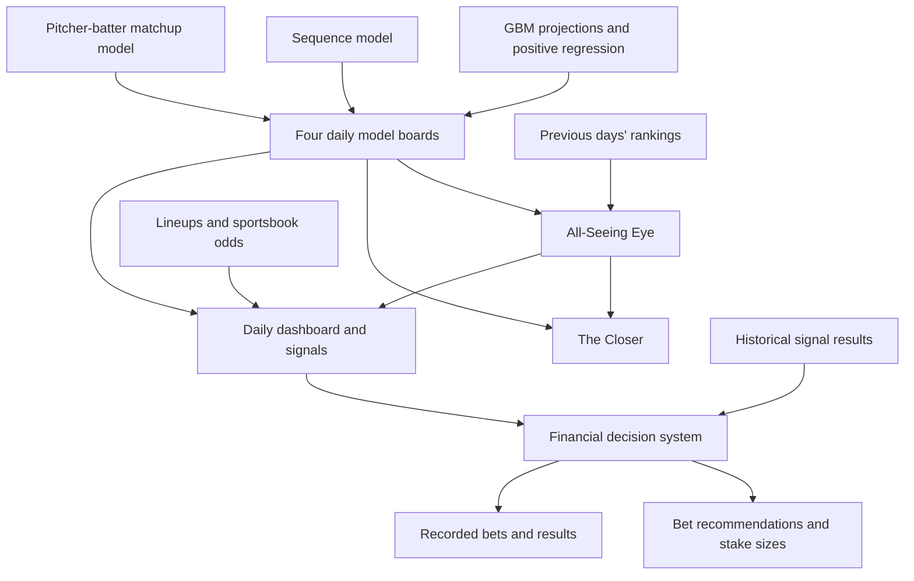

# Model Overview

Each day, the GBM produces home-run projections and positive-regression rankings,
the Sequence model identifies recent hitting patterns, and the matchup model
ranks hitters against opposing pitchers.

All-Seeing Eye compares those four boards with previous days' results to highlight
changes across the models. The daily dashboard combines their outputs with
lineups and sportsbook odds, then passes the available signals to the financial
system for bet evaluation and stake sizing.

## How the Models Connect

All-Seeing Eye can also run directly from CSV inputs. The Closer is a separate
review step available through the project menu.

## Code Map

| Component | Files | What it does |
| --- | --- | --- |
| Model inputs | [boards.py](../all_seeing_eye/boards.py), [io.py](../all_seeing_eye/io.py) | Reads the model boards and matches players across them |
| All-Seeing Eye | [scoring.py](../all_seeing_eye/scoring.py) | Scores changes, agreement, and disagreement across models |
| Command-line runner | [cli.py](../all_seeing_eye/cli.py) | Runs the Eye and saves rankings and explanations |
| The Closer | [closer.py](../all_seeing_eye/closer.py) | Reviews the Eye's top candidates |
| Daily workflow | [runner.py](../all_seeing_eye/daily_hub/runner.py) | Runs the models, refreshes data, and saves daily outputs |
| Dashboard | [app.py](../all_seeing_eye/daily_hub/app.py) | Displays boards, signals, and results |
| Financial system | [financial_system](../all_seeing_eye/financial_system/) | Evaluates bets, sizes stakes, and tracks results |
| Tests | [tests](../tests/) | Checks calculations and application behavior |

## Reading the Scores

All-Seeing Eye and The Closer produce ranking scores, not home-run probabilities.
The Sequence board also includes scouting adjustments, explained in its
[model description](model_cards/model_2_sequence.md).

Agreement across models can strengthen a player's case, but the models may share
data and signals. Their agreement should not be treated as independent
confirmation.

## Evaluation Status

Historical results help identify patterns worth investigating, but those patterns
need to be tested on later games that weren't used to select them.

The model descriptions explain the evaluations completed so far and their
limitations. The included sample demonstrates the workflow with fictional
players; it is not a performance test.
