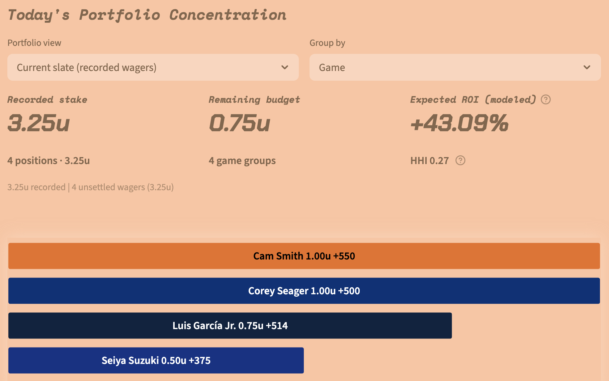
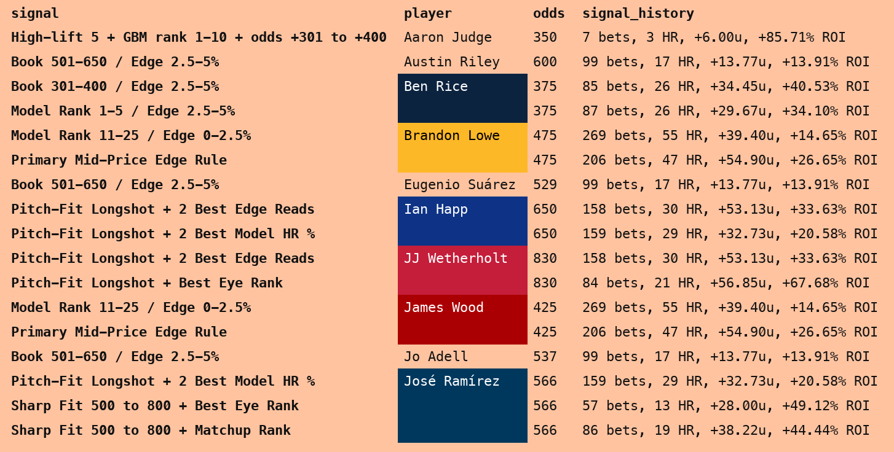
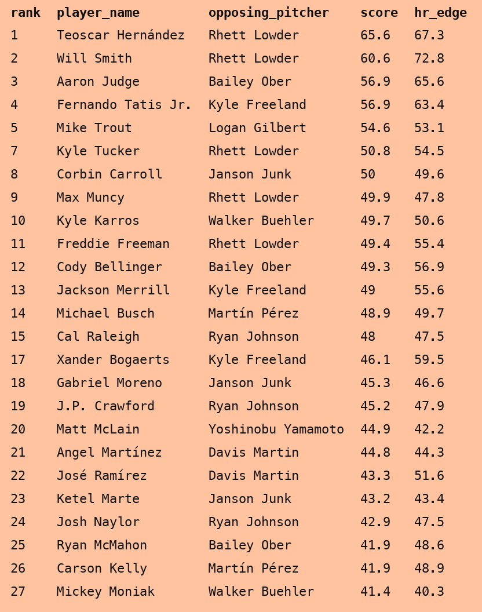
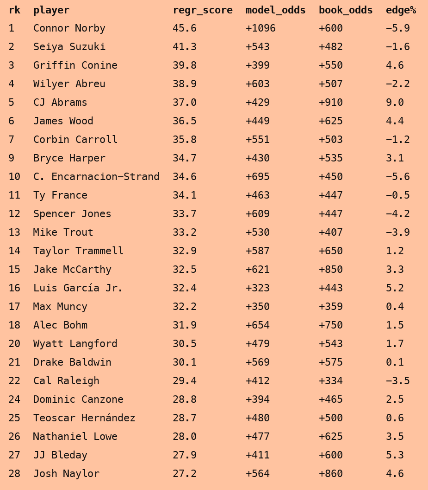

# Application Screenshots

These user-supplied captures show the project's financial portfolio and daily
analysis exports. They are historical interface examples, not live recommendations
or independently verified performance results. Unlike the synthetic CSVs under
`examples/`, these images contain real player names and displayed application data.

## Financial Portfolio

This view connects individual positions to portfolio-level exposure. It shows
four recorded wagers totaling 3.25 units, 0.75 units of remaining budget, and
four game groups. The bars identify each player's recorded stake and odds.
HHI summarizes concentration: larger values indicate more concentrated exposure.

The +43.09% figure is labeled **Expected ROI (modeled)**. It is an estimate based
on model probabilities and recorded prices, not a settled return. All four
positions are shown as unsettled. The source filename dates the screenshot to
September 19, 2026; the selected slate date is not visible in this crop.

See the [financial model card](model_cards/financial_system.md) for probability
estimation, budget allocation, and the separation of recorded wagers from
simulated recommendations.

## Daily Signal Board

The September 16, 2026 export makes the reason for each player's inclusion
visible: model-rank rules, price/edge buckets, pitch-fit conditions, and sequence
patterns appear alongside the quote and saved signal-history statistics.
Repeated player names are visually grouped, allowing several matching signals
to be inspected together.

The `signal_history` counts, home runs, unit profits, and ROI refer to each
signal's saved historical sample. They are not that day's realized results or
that player's individual career record. Signals and their historical samples can
overlap, so the displayed profits must not be summed into a portfolio return.
The image itself does not establish prospective validation or actual wager profits.

See [data sources](data_sources.md) and the
[financial system guide](financial_decision_system.md) for how overlapping
evidence and recorded outcomes are handled.

## Pitcher/Batter Matchups

The September 15, 2026 matchup export puts each hitter beside the opposing
pitcher, supporting direct comparison of matchup rankings and model scores.
It provides baseball context that a player-only prediction list would omit.

The `score` and `hr_edge` columns are model scoring fields. They should not be
read as calibrated home-run percentages or sportsbook expected returns.
The visible rank gaps are preserved from the supplied export; this gallery
does not rerank or reconstruct omitted rows.

See [Model 3: Pitcher/Batter Matchup](model_cards/model_3_matchup_regression.md).

## Positive-Regression Board

The September 15, 2026 export separates positive-regression ranking from market
price. Each row shows the regression score, model-implied odds, offered book
odds, and the displayed probability edge. A high regression rank can coexist
with a negative price edge, making the distinction between an interesting
baseball signal and a favorable quote visible.

The displayed `edge%` is a probability difference in percentage points, not ROI.
Neither the regression score nor positive edge establishes a future profitable
outcome. These are saved observations, not current quotes.

This progression/positive-regression board belongs to
[Model 1: GBM](model_cards/model_1_gbm.md), rather than Model 3's matchup board.

## Image Provenance

The supplied PNGs are copied unchanged into `docs/images/` with portable filenames.
No figures, player names, or chart values were altered. The screenshots show
different dates and should not be interpreted as one common slate or combined
evaluation sample. Operational databases and underlying private archives remain
outside the repository.
